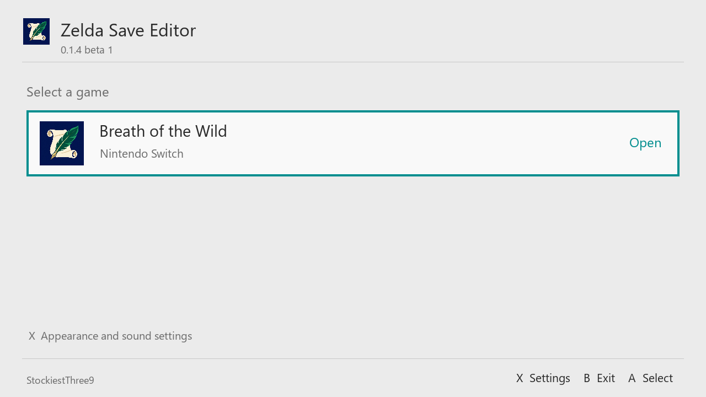

# Zelda Save Editor


**Author: StockiestThree9 · MIT license · Public beta**

A native Nintendo Switch save editor. The first game module supports **The Legend of Zelda: Breath of the Wild**.

This development branch adds **experimental Tears of the Kingdom support** in 0.1.5-alpha.1: player values, existing inventory and saved coordinates. See [TOTK features, setup and testing limits](docs/TOTK-ALPHA.md). The public beta linked below remains the BOTW release.

**[Download v0.1.4-beta.1](https://github.com/amarkham23/Zelda-Save-Editor/releases/tag/v0.1.4-beta.1)** · [Report a bug](https://github.com/amarkham23/Zelda-Save-Editor/issues) · [Changes](docs/CHANGES.md)

This is the first public beta. Keep an independent backup of your saves before editing. Browsing and audio have been tested on an OLED Switch; live save-and-reload and gameplay after profile swaps still need wider device testing. See [validation and limits](docs/VALIDATION.md).



## Features

- User profiles and a save picker with undistorted screenshots, location names, dates, manual/autosave labels and newest-first sorting.
- Automatic user selection when the console has only one user.
- Detection and editing of retained Switch 2 **Profile 2** saves, labeled separately from the original profile and Master Mode.
- Normal / Profile 2 / Master Mode tabs, opening on normal Profile 1 saves by default. Use L/R or touch to switch tabs.
- Reversible exchange of normal Profile 1 and Profile 2 saves and their normal Hero's Path, with a verified full-container backup and resumable file moves. Master Mode is excluded.
- Quill-and-scroll app artwork and a compact game selection list.
- Light, dark, automatic and **OLED black** appearance, available before choosing a save.
- Centered loading screens with an animated indicator while files are being read or written.
- HOME menu navigation sounds loaded from the console at runtime.
- Player health, stamina shown in wheels, currency, equipment capacity and ability fields.
- Inventory quantities, whole-number durability, equipment bonuses, replacement, addition and removal.
- Horse names, actor types, bond and equipment.
- World position, weather, shrine, Korok, location, compendium, enemy and quest fields.
- Daily amiibo scan reset and scan-history editing.
- Searchable advanced editor with scalar, string, vector and array access.
- Undo and redo, explicit save confirmation, verified backups and detection of saves changed since opening.

The world/completion pages currently expose named game fields. They do not yet provide the web editor's illustrated maps or coordinated “complete everything” actions. Direct quest or world edits can involve several related flags; the editor does not automatically reconcile quest progression.

## Run

Download the release ZIP and extract its `switch` folder to the root of your SD card. It installs `/switch/Zelda_Save_Editor.nro` and documentation/license notices under `/switch/zelda-save-editor/`. Existing cache, settings and backups are preserved. The standalone NRO is also available for updates.

Requires an original Nintendo Switch with Atmosphere, application-mode homebrew and an accessible BOTW save and installed game resources. The current real-save fixture is BOTW 1.9.0; compatibility with other versions has not been comprehensively tested. This app runs on the original Switch family, including OLED; it is not a native Switch 2 application.

Launch Sphaira in application mode by holding **R** while opening a game, then select **Zelda Save Editor**. Close BOTW before editing its saves.

On first use, launching Sphaira over BOTW gives the resource reader a fallback if the installed-game mount is unavailable. Resource files are cached locally under `/switch/zelda-save-editor/cache/`. The distributed app contains no Nintendo game files, font files or audio samples.

Choose Breath of the Wild and a save slot. A user picker appears only if more than one console user is available. **A** opens an item or edits a value. **B** returns. **X** opens settings. **Y** searches applicable lists. **L/R** changes inventory sections. **ZL/ZR** undoes/redoes edits. **+** opens the save confirmation. Direction buttons select rows; they never edit numbers. In Settings, select Appearance with **A** to cycle Automatic, Light, Dark and OLED black.

Every save operation verifies a backup under `/switch/zelda-save-editor/backups/<console-user>/<time>-profile<number>-slot<encoded-location>/` before writing. The backup includes the original `game_data.sav`, its companion files and a note identifying the original folder. The editor changes only the selected slot's `game_data.sav`; the game's own save thumbnail and caption remain as originally captured until BOTW next saves.

### Switch 2 game profiles

The editor scans nested save folders as well as the original slots. Transferred saves retained under `ch_01/0` through `ch_01/7` are labeled **Profile 2**. Original root slots are **Profile 1**; slots 6 and 7 are identified as Master Mode. An unfamiliar folder remains discoverable as an additional save with its location shown, rather than being assigned a guessed profile.

Profile 2 stays labeled in the picker, editor, save confirmation and backup. Ordinary editing keeps it in its original folder. [Nintendo describes the second game's save as unavailable for play in the original Switch version](https://zelda.nintendo.com/breath-of-the-wild/media/). The Profile 2 tab calls out that this location is inactive on the original Switch.

Press **Y** on the Normal or Profile 2 tab to review **Swap normal saves**. This exchanges slots 0–5, their save thumbnails and normal Hero's Path between the active Profile 1 and inactive Profile 2 locations. Master Mode saves and history stay unchanged; its tab has no swap action. Shared albums and compendium images stay at their original locations, so pictures may differ after a swap. Every original file is retained in the verified full backup. Swapping again exchanges the current normal saves, retaining progress made between swaps. The labels describe locations, not the console on which an adventure originally began. See [profile swap behavior and recovery](docs/PROFILE-SWAPS.md).

## Build

Install devkitPro's Switch toolchain and the SDL2, SDL2_image, SDL2_ttf, FreeType, HarfBuzz, PNG, JPEG, WebP, zlib, bzip2, Mesa and nouveau portlibs.

For a Git checkout, initialize submodules first. The source ZIP already includes libpulsar, so skip that command when building the ZIP.

```sh
git submodule update --init --recursive
export DEVKITPRO=/opt/devkitpro
make -j4
```

`third_party/libpulsar` is pinned to commit `3d3a057f4aa2578cdb89cab3596967c47de73b73`. See `docs/BUILD.md` for the tested version manifest.

Portable save/parser tests:

```sh
make test
./tests/test_core.exe /private/game_data.sav /private/Bootup.pack /private/Bootup_USen.pack
```

Private saves and extracted game resources are deliberately excluded from the source repository and release packages.

## Beta feedback

Please report the app version, Switch firmware, Atmosphere version, BOTW version, launch method and steps to reproduce. State whether the problem involves Normal, Profile 2 or Master Mode. Do not attach save files, account identifiers or extracted Nintendo resources to public issues. [Backup and recovery notes](docs/PROFILE-SWAPS.md) explain the profile swap process.

## License

Original application code and project artwork are released under the [MIT license](LICENSE), copyright StockiestThree9. Third-party components keep their own licenses and notices.

## Attribution

The editor and interface in `source/` and `include/` were newly written for this project. This project is not built on the previous savage13 editor or its TypeScript runtime. No source, lookup tables, styles or assets from that editor or the web editor are included.

[Marc Robledo's BOTW editor](https://www.marcrobledo.com/savegame-editors/zelda-botw/) informed the feature scope. [ZeldaMods](https://zeldamods.org/wiki/Save_Files) provides save-format documentation. Standard libraries retain their own authorship and license notices; see `THIRD_PARTY.md` and `licenses/`.

This software is based in part on the work of the Independent JPEG Group. Portions of this software are copyright © The FreeType Project (www.freetype.org). All rights reserved.

Zelda, Breath of the Wild and Nintendo Switch are trademarks of Nintendo. This is an independent, unofficial utility.
